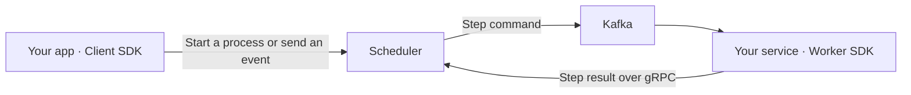

# Workflow Scheduler

Workflow Scheduler coordinates business processes across services. You describe the steps; the scheduler sends commands,
waits for results or external events, retries failed calls and runs compensation when needed.

For example: reserve stock → charge payment → wait for approval → ship the order. Inventory and Payments own their
business operations and data. The scheduler owns the sequence and execution history.

Built with .NET 10, gRPC, PostgreSQL and Kafka. Redis is an optional cache.

## Try the working example

You need Docker with Compose, `curl` and Python 3. Run from the repository root:

```bash
docker compose -f samples/order-demo/compose.yaml up --build -d
```

The first build and Kafka startup can take a few minutes. Follow the
[order demo walkthrough](samples/order-demo/README.md) to create an order, approve it and see it complete.
The demo includes the scheduler and three services, so you can see the Client and Worker SDKs working together.

## How it works



| Part | What it does |
|------|--------------|
| Scheduler | Stores definitions and process state, selects the next step, schedules retries and compensation |
| Client SDK | Registers definitions, starts processes, sends events and reads status from your application |
| Worker SDK | Receives commands inside a domain service, calls your handler and reports its result |

A **definition** is a versioned workflow template. Register it once and reuse it to start many **process instances**.
Each visit to a step creates a **step execution** with its own ID; retries of that execution also carry an attempt number.

There are three step types:

| Step | Behaviour |
|------|-----------|
| `Call` | Sends a command to a service and waits for its result |
| `WaitEvent` | Waits for a named external event |
| `Condition` | Selects a branch using a field from the original process input |

`CompensateWith` attaches an undo command to a call. On cancellation or exhausted retries, successful calls are
compensated in reverse order.

## Use it in your application

This order workflow reserves stock, charges payment, chooses an approval path and ships the order:

```csharp
using WorkflowScheduler.Client;

var definition = Workflow.Define("approved-order", version: 1)
    .Call("inventory", "ReserveStock")
    .CompensateWith("inventory", "ReleaseStock")
    .Call("payments", "ChargePayment")
    .CompensateWith("payments", "RefundPayment")
    .Condition("amount", WorkflowComparison.GreaterThanOrEqual, 1000m,
        whenTrue: branch => branch.WaitFor("OrderApproved"),
        whenFalse: branch => branch.Call("orders", "ApproveAutomatically"))
    .Call("inventory", "ShipOrder")
    .Build();
```

The condition reads `amount` from the original input. Orders of 1000 or more wait for an `OrderApproved` event; smaller
orders call `ApproveAutomatically`. Both branches continue to `ShipOrder`. If cancellation or exhausted retries trigger
compensation, completed payment and reservation calls are undone in reverse order.

Register the definition and start it with the Client SDK. Run Workers with handlers for the commands used by
`inventory`, `payments` and `orders`. The service and command names must match exactly.

| Your next step | Guide |
|----------------|-------|
| Install the Client, register a workflow and start a process | [Client SDK](src/WorkflowScheduler.Client/README.md) |
| Install the Worker and implement a command handler | [Worker SDK](src/WorkflowScheduler.Worker/README.md) |
| Trace SDK calls through complete running services | [Order demo](samples/order-demo/README.md#what-happens-inside) |

The SDK guides start with a minimal one-step workflow. Start the scheduler locally, run the Worker, then run the Client.

## Run the scheduler locally

For your own application, you need the .NET 10 SDK and Docker with Compose. From the repository root:

```bash
docker compose up -d --wait
dotnet restore WorkflowScheduler.slnx
dotnet build WorkflowScheduler.slnx

# Create the schema in a fresh development database, then exit.
dotnet run --project src/WorkflowScheduler --launch-profile http -- --initialize-database

# Start the gRPC server and background workers.
dotnet run --project src/WorkflowScheduler --launch-profile http
```

The scheduler listens at `http://localhost:5125` using HTTP/2. Keep it running while using the SDK examples.
The root Compose file starts PostgreSQL, Redis and Kafka; your application and Worker run separately.

`docker compose down` stops these dependencies and preserves PostgreSQL data. Existing PostgreSQL 17 volumes need an
explicit upgrade or dump/restore before use with the supplied PostgreSQL 18 image.

## Rules to know before integrating

- **A start response means the process was accepted.** Calls execute asynchronously. Read status to observe progress.
- **Events are accepted only at the matching waiting step.** There is no early-event inbox. A process status of `Waiting`
  alone is insufficient: it may be waiting for a call result rather than an external event.
- **Delivery is at least once.** A handler can run again after a crash. Persist its operation and result using the Worker
  context's idempotency key. Keep a business-level key too if an operation must stay unique across retry attempts.
- **Reuse request identities when retrying.** Keep the same start idempotency key or event correlation ID. Registration
  rejects an existing name/version; retrieve that definition instead of registering it again.
- **Calls retry up to three times after the initial attempt**, with a 30-second delay between attempts. A missing callback
  does not trigger an automatic timeout.
- **Each call receives the original input.** Outputs and event payloads are recorded in history; they are not merged into
  later calls or condition input.
- **Cancellation is cooperative.** Already executing operations may finish. Only acknowledged successful calls are
  automatically compensated. A process can be `Cancelled` or `Failed` while compensation is still running.

## Current scope

Sequential workflows, conditional branches and loops through calls or waiting steps are supported. The SDK builder
supports sequences and branches; arbitrary graphs and loops require direct definition registration.

There are no parallel branches, timers, cron schedules, script execution or visual designer. Authentication and
authorization are not implemented in the gRPC server; configure access control and TLS at the deployment boundary.
Exhausted compensation needs operator intervention; there is no recovery API yet.

## Reference

<details>
<summary>Server configuration and database upgrades</summary>

Development defaults are in [appsettings.Development.json](src/WorkflowScheduler/appsettings.Development.json).
Outside development, supply your own configuration. Environment variables use `__` for nesting.

| Setting | Local value or purpose |
|---------|------------------------|
| `ConnectionStrings:Postgres` | `Host=localhost;Port=5432;Database=workflow;Username=workflow;Password=workflow` |
| `ConnectionStrings:Redis` | `localhost:6379,abortConnect=false`; omit or clear the effective value to disable caching |
| `Kafka:BootstrapServers` | `localhost:9092` |
| `Kafka:ProducerConfig` | Kafka security settings, including `SecurityProtocol`, `SaslMechanism`, credentials and CA path |
| `Kestrel:Endpoints:Grpc:Url` | `http://localhost:5125` |
| `Kestrel:Endpoints:Grpc:Protocols` | `Http2` for the plaintext local endpoint |

For example, set `Kafka__BootstrapServers=broker:9092` and
`Kafka__ProducerConfig__SecurityProtocol=SaslSsl` for a secured broker, together with its required credentials and
certificate settings. Producer idempotence and acknowledgements from all in-sync replicas remain enabled.
Redis failures fall back to PostgreSQL; durable process state and deduplication do not depend on Redis.

For an existing schema, stop old scheduler instances and run `--initialize-database` with the target database configured.
It preserves rows and applies the included [outbox upgrade](database/001_outbox_delivery.sql) and
[execution indexes](database/002_execution_sequence.sql). The same SQL can be applied by deployment tooling.
`EnsureCreated` creates fresh schemas; it is not a general migration system. Other schema changes need explicit migrations.

</details>

<details>
<summary>Direct gRPC and Kafka integration, including non-.NET services</summary>

.NET services can use the Worker SDK for command consumption and callbacks. Implement the following protocol yourself
when integrating without that SDK.

Each RPC has a separate service named `workflow.<Name>`; generated C# types use `WorkflowScheduler.Grpc`.

| RPC | Contract |
|-----|----------|
| `RegisterProcessDefinition` | [Definition registration](src/WorkflowScheduler.Contracts/Processes/register_process_definition.proto) |
| `GetProcessDefinition` | [Lookup by name/version](src/WorkflowScheduler.Contracts/Processes/get_process_definition.proto) |
| `StartProcess` | [Start with an idempotency key](src/WorkflowScheduler.Contracts/Processes/start_process.proto) |
| `SendEvent` | [External event](src/WorkflowScheduler.Contracts/Processes/send_event.proto) |
| `CancelProcess` | [Cancellation](src/WorkflowScheduler.Contracts/Processes/cancel_process.proto) |
| `GetProcessStatus` | [Status and paged history](src/WorkflowScheduler.Contracts/Processes/get_process_status.proto) |
| `CompleteStep` | [Success or failure callback](src/WorkflowScheduler.Contracts/Steps/complete_step.proto) |
| `IsStepActive` | [Execution activity check](src/WorkflowScheduler.Contracts/Steps/is_step_active.proto) |

Commands go to `process.commands.<serviceName>` with the process ID as the Kafka key. The JSON envelope uses PascalCase:

```json
{
  "ProcessInstanceId": "<process UUID>",
  "StepDefinitionId": "<definition-step UUID>",
  "StepInstanceId": "<execution UUID>",
  "Command": "ReserveStock",
  "InputData": "{\"orderId\":42}",
  "CorrelationId": "<execution UUID>",
  "Attempt": 0,
  "IsCompensation": false
}
```

Check activity for the exact execution/attempt, deduplicate the operation, then report its saved result through
`CompleteStep`. Echo the process, definition-step and execution IDs plus `Attempt`; preserve the callback correlation
ID across transport retries. The command correlation stays stable for the execution, so callbacks for different
attempts need distinct correlation IDs. A duplicate callback is rejected; reconcile it with `IsStepActive` before
acknowledging delivery. Lifecycle events are not published.

Definitions have a unique name/version and globally unique step IDs. The first supplied step is the entry step.
References must stay within the definition. Metadata is a JSON object encoded as a string; property names are
case-insensitive and duplicates are rejected.

| Type | Metadata fields |
|------|-----------------|
| `CALL` | `serviceName`, `command` |
| `WAIT_EVENT` | `eventName` |
| `CONDITION` | `inputKey`, `operator`, `value`, `trueNextStepId`, `falseNextStepId` |

Conditions read a top-level input field. Operators are `eq`, `ne`, `gt`, `lt`, `gte`, `lte`; equality is case-sensitive
text comparison and numeric ordering uses invariant decimal parsing. Missing fields or invalid numeric input take the
false branch. Compensation targets must be separate terminal calls outside the forward path. Condition-only cycles
are rejected; cycles through a call or waiting step are allowed.

Input must be a JSON object and fit within 980,000 bytes after JSON string escaping. Callback output is limited to
3 MiB of UTF-8 data. Event names allow 250 characters, commands 256 and business keys 512. Input fingerprints compare
the supplied JSON string, so whitespace and property order matter when retrying a start.

`GetProcessStatus` accepts `historyOffset`, `historyPageSize` (1..100) and `omitOutputData`. Omitting paging returns the
full history. Main errors are `InvalidArgument`, `NotFound`, `FailedPrecondition` and `Internal`.

Server reflection is disabled. Supply the proto when using `grpcurl`:

```bash
grpcurl -plaintext \
  -import-path src/WorkflowScheduler.Contracts \
  -proto Processes/get_process_status.proto \
  -d '{"processInstanceId":"<process UUID>"}' \
  localhost:5125 workflow.GetProcessStatus/GetProcessStatus
```

</details>

<details>
<summary>Delivery recovery and operational limits</summary>

Process changes and outbox commands commit together in PostgreSQL. Process mutations and each bounded outbox delivery
use a process advisory lock. Separate processes can progress independently.

Dispatchers claim up to 100 messages using `FOR UPDATE SKIP LOCKED` and a one-minute lease. Each delivery rechecks
ownership and process status under the process lock, with a ten-second timeout including lock acquisition. Crashed
claims expire; unfinished claims are released. A broker acknowledgement lost before the database update can cause
redelivery.

Outbox failures retry after 2, 4, 8, 16, 32, then 60 seconds. Invalid or oversized records and records failing eight
attempts are quarantined with `FailedAt`. Quarantine leaves the workflow waiting. Inspect `Error`, fix its cause and
then reset `FailedAt`, `NextAttemptAt` and `Attempts` for the affected record if replay is appropriate.

The retry worker polls due steps every two seconds. Retry attempts retain the execution ID and increment `Attempt`;
late callbacks cannot complete a newer attempt. Compensation uses the same retry policy and stops if a compensation
exhausts its retries. Inspect `saga_compensation_logs` and domain-service state before intervening.

There is no automatic history retention policy, lifecycle-event stream, metrics dashboard or general migration history.

</details>

<details>
<summary>Developing and testing the scheduler</summary>

Server code lives in `src/WorkflowScheduler`, grouped by feature. Contracts, Client and Worker are separate projects.
Domain services depend on the SDKs rather than the server application.

```bash
# Full suite; Docker must be running. Testcontainers starts shared PostgreSQL, Redis and Kafka instances.
dotnet test WorkflowScheduler.slnx

# Unit tests without Docker.
dotnet test WorkflowScheduler.slnx --filter 'Category=Unit'

# Coverage.
dotnet test WorkflowScheduler.slnx --collect:'XPlat Code Coverage' --settings coverage.runsettings
```

Integration and E2E tests share a collection fixture, isolate database/cache state and use real Kafka. E2E tests run
Kestrel and the SDKs in the test process. CI also runs the demo's HTTP smoke scenarios in Docker Compose.

</details>

<details>
<summary>Load testing with k6</summary>

Start the [local scheduler](#run-the-scheduler-locally) and install [k6](https://grafana.com/docs/k6/latest/set-up/install-k6/).
Run from the repository root against an isolated benchmark database. These workloads retain process history and receipts;
each run registers uniquely named definitions. No external JavaScript dependencies or server reflection are needed.

```bash
# Ten iterations with one VU, exercising every workload in the default mix.
k6 run -e PROFILE=smoke tests/load/scheduler.js

# Offer 20 workload iterations per second for three minutes.
k6 run -e PROFILE=load -e RATE=20 -e DURATION=3m tests/load/scheduler.js

# Ramp through RATE, 3 * RATE and 5 * RATE, then ramp down.
k6 run -e PROFILE=stress -e RATE=20 tests/load/scheduler.js

# Hold a steady rate to observe resource growth over time.
k6 run -e PROFILE=soak -e RATE=20 -e DURATION=30m tests/load/scheduler.js
```

`RATE` counts workload iterations, not RPCs. An iteration issues 1..6 RPCs depending on its workload. Arrival-rate
profiles keep offering iterations as the server slows down; there is no sleep-based pacing. `dropped_iterations`
means the generator could not sustain that rate with its configured VU capacity.

| `WORKLOAD` | Behaviour |
|------------|-----------|
| `mixed` (default) | 40% workflow, 30% read, 10% replay, 10% callback, 10% cancel |
| `workflow` | Start a condition-based workflow, send the selected approval event and verify completion |
| `read` | Read bounded status pages from a pool of completed processes created during setup |
| `replay` | Reuse one accepted start request across all VUs to measure idempotency and hot-key contention |
| `callback` | Start a call, check activity, submit its callback, send an event and verify completion |
| `cancel` | Start a waiting process, cancel it and verify its persisted status |

Select one workload with `-e WORKLOAD=read`, for example. The callback workload **simulates the Worker response over
gRPC**; it does not measure Kafka consumption, business-handler latency or end-to-end delivery. Its commands use a
unique `k6-<run UUID>` service name. Other workloads use waiting/condition steps and do not publish commands.

| Setting | Default |
|---------|---------|
| `GRPC_TARGET` | `localhost:5125`, without a URL scheme |
| `PLAINTEXT` | `true`; set `false` for TLS |
| `RPC_TIMEOUT` / `SETUP_TIMEOUT` | `10s` / `2m` |
| `PRE_ALLOCATED_VUS` / `MAX_VUS` | `10` / `100` for arrival-rate profiles |
| `SEED_COUNT` | `10` completed processes for reads |
| `PAYLOAD_BYTES` | `0` bytes of extra ASCII input, up to `900000` |
| `RAMP_DURATION` / `STAGE_DURATION` | `30s` / `1m` for stress stages |
| `RPC_P95_MS` / `RPC_P99_MS` | `500` / `1000` |
| `WORKLOAD_P95_MS` | `3000` |

`BEARER_TOKEN` optionally supplies authorization metadata for a protected deployment boundary. `PROTO_ROOT` overrides
the proto import directory when relocating the scripts.

The pass criteria are at least 99% successful checks and workloads, under 1% failed RPCs, the configured p95/p99 latency
limits and zero dropped iterations. Setup RPCs are tagged separately and excluded from those latency/failure criteria.
Thresholds are starting targets to tune for your environment, not published scheduler performance guarantees.
`workload_duration` and `workload_success` carry a workload tag; gRPC metrics and `rpc_failures` identify each RPC.
Process IDs are not metric tags, which keeps metric cardinality bounded.

To save the raw time series, create the output directory and add a JSON output:

```bash
mkdir -p artifacts/k6
k6 run -e PROFILE=load --out json=artifacts/k6/results.json tests/load/scheduler.js
```

Results stay under the ignored `artifacts` directory. Investigate resource saturation, RPC errors and dropped iterations
together; a slower workload may require more generator VUs rather than a higher request rate.

</details>

## License

[MIT](LICENSE).
