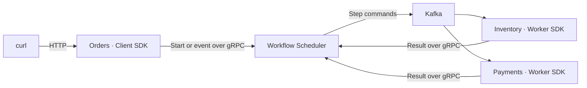

# Order workflow demo

This example shows how to call Workflow Scheduler from inside your services:

- **Orders** uses the Client SDK to register a workflow, start it and send approval events.
- **Inventory** uses the Worker SDK to reserve, release and ship stock.
- **Payments** uses the Worker SDK to charge and refund payment.

The workflow is: **reserve stock → charge payment → wait for approval → ship**.
Each service owns its database. The scheduler controls the sequence, retries and compensation.

## Start the demo

You need Docker with Compose, `curl` and Python 3. Run all commands from the repository root in the same shell:

```bash
docker compose -f samples/order-demo/compose.yaml up --build -d
DEMO_URL=http://localhost:5080
curl --fail-with-body "$DEMO_URL/health"
```

The first build and Kafka startup can take a few minutes. Retry the health request until it returns `200`.
This starts all services and dependencies; you do not need to start the root Compose stack or a separate scheduler.
Only Orders exposes a host port. Other services communicate inside Docker.

## Complete one order

Create an order:

```bash
ORDER_ID=$(python3 -c 'import uuid; print(uuid.uuid4())')
curl --fail-with-body "$DEMO_URL/api/orders" \
  -H 'Content-Type: application/json' \
  --data "{\"orderId\":\"$ORDER_ID\",\"amount\":1490,\"paymentFailure\":\"None\"}"
```

The response is `201` with the order's `id` and scheduler `processId`. Read its state:

```bash
curl --fail-with-body "$DEMO_URL/api/orders/$ORDER_ID" | python3 -m json.tool
```

Repeat this GET until the **current step** is waiting for approval. In `process.stepHistory`, find the entry whose `id`
matches `process.currentStepId`. That entry must have `status: "Waiting"`; reservation and payment should be complete:

```text
process.status                              Waiting
current step's status                       Waiting
inventory.state                             Reserved
payment.state                               Charged
```

A process status of `Waiting` alone is not enough: it is also used while a command is running. A current step with
`status: "Running"` is still awaiting its Worker callback. Sending approval too early returns `409`.

Approve the order:

```bash
curl --fail-with-body -i -X POST "$DEMO_URL/api/orders/$ORDER_ID/approve"
```

The response is `204`. Repeat the GET until `process.status` is `Completed` and `inventory.state` is `Shipped`.
You have now exercised Client start → Worker handlers → an external event → workflow completion.

Repeating order creation with the same UUID and input returns the same process. Changing the input for that UUID
returns `409`. The GET response includes step history and each service's saved operations.

## What happens inside



[OrderWorkflow.cs](OrderDemo.Orders/OrderWorkflow.cs) builds the definition:

```csharp
Workflow.Define("samples.order-demo", 1)
    .Call(DemoCommands.Inventory, DemoCommands.Reserve)
    .CompensateWith(DemoCommands.Inventory, DemoCommands.Release)
    .Call(DemoCommands.Payments, DemoCommands.Charge)
    .CompensateWith(DemoCommands.Payments, DemoCommands.Refund)
    .WaitFor(DemoCommands.Approval)
    .Call(DemoCommands.Inventory, DemoCommands.Ship)
    .Build();
```

`.Call` declares work in another service. `.WaitFor` pauses until the application sends an event.
`.CompensateWith` supplies an undo command for a completed call.

The internal path is:

1. [OrderEndpoints.CreateAsync](OrderDemo.Orders/OrderEndpoints.cs) saves the order. `OrderWorkflow.GetOrRegisterAsync`
   retrieves or registers the definition, then the endpoint starts a process using the order UUID as its idempotency key:

   ```csharp
   var definition = await workflow.GetOrRegisterAsync(ct);
   var persistedInput = new OrderInput(order.Id, order.Amount, order.PaymentFailure);
   var processId = await scheduler.StartAsync(
       definition, persistedInput, $"order:{order.Id:N}", order.Id, ct);
   ```

2. The scheduler saves the process and an outbox command together, then publishes to `process.commands.demo-inventory`.
3. [Inventory's Program.cs](OrderDemo.Inventory/Program.cs) registers `ReserveStock`, `ReleaseStock` and `ShipOrder`
   handlers through `AddWorkflowSchedulerWorker(...).Handle<...>(...)`.
4. [InventoryHandler](OrderDemo.Inventory/InventoryHandler.cs) commits the operation and its execution receipt. The
   Worker SDK reports its result through `CompleteStepAsync` or `FailStepAsync`; the handler does not send that callback.
5. The scheduler sends payment work through `process.commands.demo-payments`. [PaymentHandler](OrderDemo.Payments/PaymentHandler.cs)
   follows the same pattern. After payment succeeds, the process reaches `WaitFor("OrderApproved")`.
6. The Orders approval endpoint calls `SendEventAsync`. The scheduler then dispatches `ShipOrder` to Inventory.

The scheduler does not call Inventory or Payments over HTTP. Those HTTP endpoints are used by Orders to show their
business state in the combined GET response. Workflow commands use Kafka and callbacks use gRPC.

## Try retries and compensation

For each scenario, generate a **new `ORDER_ID`** and repeat the creation request with the indicated `paymentFailure`:

| Scenario | Value | Expected result |
|----------|-------|-----------------|
| Success | `None` | Order waits for approval, then ships after approval |
| Temporary payment failure | `Once` | Attempt 0 fails; attempt 1 succeeds after about 30 seconds |
| Persistent payment failure | `Always` | Four failed attempts over about 90 seconds; process becomes `Failed`, stock is released |
| Cancellation | `None` | At the approval checkpoint, cancel to refund payment and release stock |

To cancel a paid order, wait for the same approval checkpoint described above, then call:

```bash
curl --fail-with-body -i -X POST "$DEMO_URL/api/orders/$ORDER_ID/cancel"
curl --fail-with-body "$DEMO_URL/api/orders/$ORDER_ID" | python3 -m json.tool
```

Repeat the GET until payment is `Refunded` and inventory is `Released`. Compensation runs in reverse order: refund,
then release. The process may become `Cancelled` before those operations finish. This demo accepts cancellation only
at the approval checkpoint; other stages return `409`.

Inventory and payments are simulated. The handlers persist receipts to deduplicate local operations. A real payment
provider also needs its own business idempotency and reconciliation.

## Stop and inspect

```bash
docker compose -f samples/order-demo/compose.yaml logs -f orders inventory payments scheduler
docker compose -f samples/order-demo/compose.yaml down
```

`down` preserves data. Add `--volumes` only when you want to delete the demo's data.
The supplied PostgreSQL 18 image cannot directly reuse an old PostgreSQL 17 data volume; upgrade or dump/restore it first.

<details>
<summary>Run the smoke scenarios automatically</summary>

With the demo running:

```bash
python3 samples/order-demo/scripts/smoke.py --url "$DEMO_URL"
```

This checks successful completion, creation replay, delayed retries, cancellation and compensation through HTTP and the
real SDKs. Allow about two minutes. It does not shorten retry delays or modify the scheduler database.

</details>

<details>
<summary>If the Docker build cannot reach NuGet</summary>

If the host can reach NuGet but the Docker build network cannot, build with host networking:

```bash
docker compose -f samples/order-demo/compose.yaml -f samples/order-demo/compose.host-build.yaml build --print \
  | docker buildx bake -f - --allow=network.host --load
docker compose -f samples/order-demo/compose.yaml up -d
```

Running services keep their Compose network.

</details>
