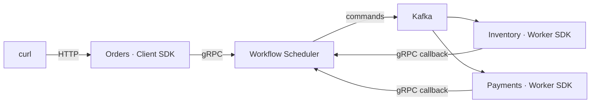

# Order workflow demo

Three services demonstrate an order workflow: **Orders** starts it through the Client SDK, **Inventory** reserves and
ships stock, and **Payments** simulates charges/refunds. Each service owns its database. The scheduler controls step
order, retries and compensation; Kafka carries commands, and workers report results over gRPC.



## Run

Requirements: Docker with Compose, `curl` and Python 3. Run from the repository root, in the same shell:

```bash
docker compose -f samples/order-demo/compose.yaml up --build -d
DEMO_URL=http://localhost:5080
curl --fail-with-body "$DEMO_URL/health"
```

The first build and Kafka startup can take a few minutes. Retry `/health` until it returns `200`.
Only Orders exposes a host port; other services communicate inside Docker.

## What happens inside

[OrderWorkflow.cs](OrderDemo.Orders/OrderWorkflow.cs) defines the sequence and its undo commands:

```csharp
Workflow.Define("samples.order-demo", 1)
    .Call(DemoCommands.Inventory, DemoCommands.Reserve, "Reserve stock")
    .CompensateWith(DemoCommands.Inventory, DemoCommands.Release, "Release stock")
    .Call(DemoCommands.Payments, DemoCommands.Charge, "Charge payment")
    .CompensateWith(DemoCommands.Payments, DemoCommands.Refund, "Refund payment")
    .WaitFor(DemoCommands.Approval, "Approve order")
    .Call(DemoCommands.Inventory, DemoCommands.Ship, "Ship order")
    .Build();
```

`.Call` declares a step. `CompensateWith` attaches compensation to that step; completed steps are compensated in reverse
order. `WaitFor` pauses the process until an external event arrives.

[OrderEndpoints.cs](OrderDemo.Orders/OrderEndpoints.cs) saves the order, looks up or registers the definition, starts
the
process and saves its ID:

```csharp
var definition = await workflow.GetOrRegisterAsync(ct);
var persistedInput = new OrderInput(order.Id, order.Amount, order.PaymentFailure);
var processId = await scheduler.StartAsync(
    definition, persistedInput, $"order:{order.Id:N}", order.Id, ct);
```

The scheduler persists a command in its outbox and publishes it to `process.commands.demo-inventory`.
Inventory's [Program.cs](OrderDemo.Inventory/Program.cs) registers the command handlers:

```csharp
builder.Services.AddWorkflowSchedulerWorker(options =>
    {
        options.ServiceName = DemoCommands.Inventory;
        options.BootstrapServers = builder.Configuration["Kafka:BootstrapServers"]!;
    })
    .Handle<OrderInput, OperationResult, InventoryHandler>(DemoCommands.Reserve)
    .Handle<OrderInput, OperationResult, InventoryHandler>(DemoCommands.Release)
    .Handle<OrderInput, OperationResult, InventoryHandler>(DemoCommands.Ship);
```

The Worker SDK calls [InventoryHandler.HandleAsync](OrderDemo.Inventory/InventoryHandler.cs). The handler commits its
business state and execution receipt, then returns a result or throws. The SDK automatically calls `CompleteStepAsync`
or `FailStepAsync` over gRPC. A successful callback advances the workflow; failure lets the scheduler schedule a retry.
[Payments](OrderDemo.Payments/PaymentHandler.cs) follows the same mechanism via `process.commands.demo-payments`.

After payment, Orders sends approval with `SendEventAsync(processId, DemoCommands.Approval, ...)`; the scheduler
then dispatches `ShipOrder`. Cancellation uses `CancelAsync(processId, ct)` and triggers compensation.

## Call the system

Create an order and read its state:

```bash
ORDER_ID=$(python3 -c 'import uuid; print(uuid.uuid4())')
curl --fail-with-body "$DEMO_URL/api/orders" \
  -H 'Content-Type: application/json' \
  --data "{\"orderId\":\"$ORDER_ID\",\"amount\":1490,\"paymentFailure\":\"None\"}"

curl --fail-with-body "$DEMO_URL/api/orders/$ORDER_ID" | python3 -m json.tool
```

Creation returns `201` with the order `id` and scheduler `processId`. Repeat the GET until the approval checkpoint.
These selected fields show that payment and reservation have completed:

```json
{
  "process": { "status": "Waiting" },
  "inventory": { "state": "Reserved" },
  "payment": { "state": "Charged" }
}
```

Approve the order and read it again:

```bash
curl --fail-with-body -i -X POST "$DEMO_URL/api/orders/$ORDER_ID/approve"
curl --fail-with-body "$DEMO_URL/api/orders/$ORDER_ID" | python3 -m json.tool
```

Approval returns `204`. Repeat the GET until `process.status` is `Completed` and `inventory.state` is `Shipped`.
The full response includes `process.stepHistory` and each worker's `operations`: commands, attempts, results and
timestamps.

Repeating creation with the same UUID and input recovers the same process; different input returns `409`.

## Try failures and compensation

For each scenario, generate a **new `ORDER_ID`** and repeat creation with the indicated `paymentFailure` value.

| Scenario          | Value    | What to observe                                                                                      |
|-------------------|----------|------------------------------------------------------------------------------------------------------|
| Success           | `None`   | Reserve → pay → wait for approval → ship                                                             |
| Retry             | `Once`   | Payment attempt `0` fails; attempt `1` succeeds after 30 seconds, then waits for approval            |
| Exhausted retries | `Always` | Four failed payment attempts over about 90 seconds; process becomes `Failed`, stock is released      |
| Cancellation      | `None`   | At the approval checkpoint, cancel instead of approving; payment is refunded, then stock is released |

To cancel a paid order waiting for approval:

```bash
curl --fail-with-body -i -X POST "$DEMO_URL/api/orders/$ORDER_ID/cancel"
curl --fail-with-body "$DEMO_URL/api/orders/$ORDER_ID" | python3 -m json.tool
```

Wait for `payment.state: "Refunded"` and `inventory.state: "Released"`. The process can become `Cancelled` before
compensation finishes. This demo accepts cancellation only at the approval checkpoint; other stages return `409`.

Stock and payments are simulated. Saved execution receipts protect duplicate local effects; external payment providers
need their own idempotency and reconciliation.

## Stop

```bash
docker compose -f samples/order-demo/compose.yaml down
```

Data is preserved. Add `--volumes` to delete this sample's data.

<details>
<summary>Tests and logs</summary>

With .NET 10 installed, run unit and PostgreSQL Testcontainer tests:

```bash
dotnet test samples/order-demo/OrderDemo.slnx --configuration Release
```

With Compose running, verify all four scenarios through HTTP and real Kafka/gRPC, including normal retry delays:

```bash
python3 samples/order-demo/scripts/smoke.py
docker compose -f samples/order-demo/compose.yaml logs -f orders inventory payments scheduler
```

Allow about two minutes for the smoke test.

</details>

<details>
<summary>Docker build cannot reach NuGet</summary>

If the host can reach NuGet but the Linux Docker bridge cannot, use host networking for build steps:

```bash
docker compose -f samples/order-demo/compose.yaml -f samples/order-demo/compose.host-build.yaml build --print \
  | docker buildx bake -f - --allow=network.host --load
docker compose -f samples/order-demo/compose.yaml up -d
```

Running services keep their isolated Compose network.

</details>
